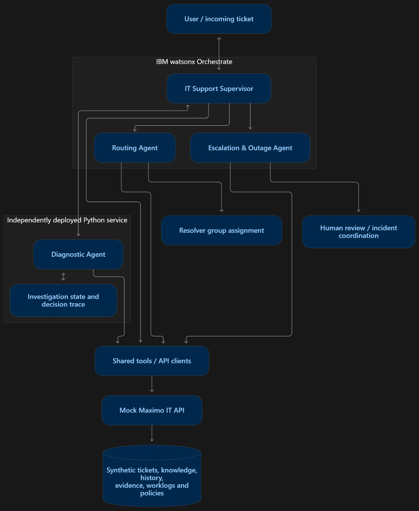

# ISYS Agentic IT Diagnosis & Resolution

An agentic IT support prototype that investigates symptoms, gathers evidence, and reaches a supported diagnosis before resolving, routing, or escalating a ticket. IBM watsonx Orchestrate coordinates a portable Python/LangGraph diagnostic agent with routing, escalation, and a mock Maximo IT backend. All ticket and knowledge data is synthetic.

**Diagnostic flow:** Symptoms → Candidate diagnoses → Questions and checks → Evidence → Eliminate alternatives → Diagnosis → Resolve / Route / Escalate

## Architecture



The diagram shows the logical architecture and the independently deployable Python service. This repository also provides a native LangGraph bundle that WXO hosts directly; that deployment does not require the local diagnostic HTTP service.

| Component | Responsibility |
| --- | --- |
| IT Support Supervisor | Manages intake, the user conversation, and collaborator dispatch. |
| Diagnostic Agent | Maintains investigation state, selects questions and checks, evaluates evidence, and performs permitted guided resolution. |
| Routing Agent | Uses the recorded diagnosis and evidence to recommend or assign the appropriate resolver group. |
| Escalation & Outage Agent | Screens shared incidents, coordinates required human review, and handles permitted global-ticket operations. |
| Mock Maximo IT API | Stores synthetic tickets, diagnostic results, evidence, worklogs, assignments, and policy records. |

Decisions and completed actions are recorded against the ticket. Missing evidence remains explicit, and resolution, assignment, and incident actions follow the backend's approval and safety gates.

## Repository guide

| Path | Contents |
| --- | --- |
| [Agents/](Agents/) | Named native agent definitions and import ZIPs, including diagnostic v6.8.3 |
| [diagnostic-agent/](diagnostic-agent/) | Editable Python implementation, HTTP host, native bundle builder, and tests |
| [backend/](backend/) | FastAPI mock backend, OpenAPI tool definitions, synthetic fixtures, and tests |
| [knowledge/](knowledge/) | Reviewed knowledge source, upload material, policies, and approval register |
| [evaluation/](evaluation/) | Offline test tickets, hidden answers, and manual acceptance scenarios |
| [docs/](docs/) | Setup, WXO integration, architecture, requirements, and assembly notes |
| [scripts/](scripts/) | Packaging utilities for native agent exports |

See [configuration and datasets](docs/SETUP.md), [WXO import instructions](docs/WXO_IMPORT.md), and [assembly notes](docs/ASSEMBLY_NOTES.md) for deployment details and known gaps.

## Run locally

Use **Python 3.12** and **PowerShell**. Start each component from the repository root in a separate terminal, with its own virtual environment.

### 1. Configure and start the backend

```powershell
cd backend
py -3.12 -m venv .venv
.\.venv\Scripts\python.exe -m pip install -r requirements.lock
Copy-Item .env.example .env
```

Edit `backend/.env` and set different random values for `API_KEY` and `ADMIN_API_KEY`. Then load the merged Workstream A fixtures and start the API:

```powershell
$env:ADMIN_COMMAND_KEY = Read-Host 'Admin key from backend/.env'
.\.venv\Scripts\python.exe -m scripts.import_data --data-dir data/workstream_a
.\.venv\Scripts\python.exe -m uvicorn app.main:app --host 127.0.0.1 --port 8000
```

Open [backend Swagger](http://127.0.0.1:8000/docs) and authorize with the service key. `TST-0001` is an example ticket in the Workstream A profile. Omit `--data-dir data/workstream_a` to import the starter fixtures instead. Fixture import is explicit; starting the API does not load data.

### 2. Configure and start the diagnostic service

In another terminal, from the repository root:

```powershell
cd diagnostic-agent
py -3.12 -m venv .venv
.\.venv\Scripts\python.exe -m pip install -r requirements-dev.txt
Copy-Item .env.example .env
```

Edit `diagnostic-agent/.env`:

| Setting | Local value |
| --- | --- |
| `DIAGNOSTIC_BACKEND_BASE_URL` | `http://127.0.0.1:8000` |
| `DIAGNOSTIC_BACKEND_API_KEY` | The backend's `API_KEY` |
| `DIAGNOSTIC_SERVICE_API_KEY` | A separate random key for the diagnostic HTTP service |

```powershell
.\Start-Agent.ps1
```

Open [diagnostic Swagger](http://127.0.0.1:8080/docs), authorize with the diagnostic service key, and call `POST /langgraph/chat`:

```json
{"session_id":"demo-graph","mode":"backend","message":"Investigate TST-0001"}
```

Use the same `session_id` when answering the next diagnostic question. For example, if the answer is unknown:

```json
{"session_id":"demo-graph","mode":"backend","message":"I don't know"}
```

## Connect to watsonx Orchestrate

Follow the [WXO import guide](docs/WXO_IMPORT.md) to expose the backend, configure credentials, import tools and knowledge, and reconnect collaborators. The diagnostic agent uses the team API-key connection `isys_it_backend`.

Import bundles are in [Agents/ZIP/](Agents/ZIP/):

- `ISYS_Diagnostic_Agent_v6.8.3.zip`
- `Routing_Agent.zip`
- `Escalation_Outage_Agent.zip`
- `IT_Support_Supervisor.zip`

Configure a backend URL reachable from WXO before deployment. Tool IDs and knowledge bindings must match the destination tenant. The supervisor was reconstructed from local instructions v1.16 and guidelines v1.5 and still requires tenant validation.

## Verify and rebuild

From `backend/`, using its virtual environment:

```powershell
.\.venv\Scripts\python.exe -m pytest
.\.venv\Scripts\python.exe -m scripts.validate_openapi
```

From `diagnostic-agent/`, using its virtual environment:

```powershell
.\.venv\Scripts\python.exe -m pytest -q
.\.venv\Scripts\python.exe scripts/build_langgraph_package.py
.\.venv\Scripts\python.exe scripts/verify_langgraph_package.py
```

The rebuilt diagnostic bundle is `diagnostic-agent/dist/isys-diagnostic-langgraph-v6.8.3.zip`. Copy it to `Agents/ZIP/ISYS_Diagnostic_Agent_v6.8.3.zip` when releasing an update. To rebuild the native agent ZIPs from their editable definitions, run this command from the repository root:

```powershell
py -3.12 scripts/package_native_agents.py
```

Assembly verification on **29 October 2026** passed **273 diagnostic tests** and portable-bundle checks for isolated loading, conversation resume, and ZIP integrity. The backend suite and live WXO execution were not run during assembly. See the [validation record](docs/ASSEMBLY_VALIDATION.json).

## Data and project status

Keep evaluation answers outside knowledge uploads and runtime imports. Local content review or upload does not activate draft policies or grant operational approval. Credentials, virtual environments, runtime databases, and original export backups are excluded by `.gitignore`.

This is a synthetic-data prototype. The [assembly notes](docs/ASSEMBLY_NOTES.md) document remaining gaps, including the unavailable original Workstream A generator/evaluator and pending WXO tenant validation.
