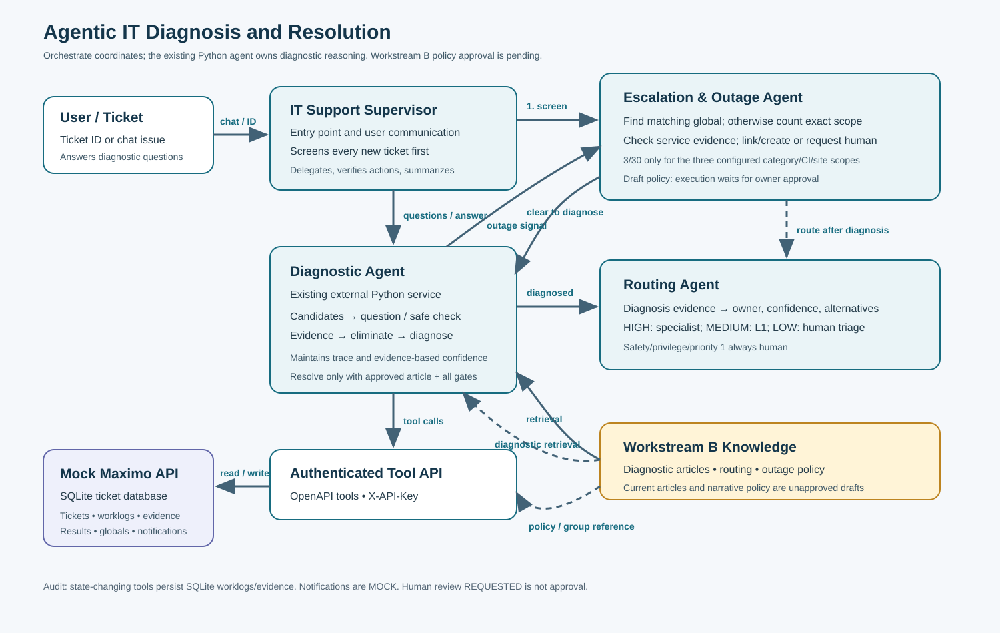

# Diagnostic Decision Flow

**Project:** ISYS Agentic IT Diagnosis & Resolution  
**Version:** 1.0  
**Date:** 24 October 2026  
**Status:** Design reference; Workstream B approval remains pending.

## Purpose and ownership

This document describes how an incoming ticket moves through the Supervisor, the existing external Python Diagnostic Agent, the Routing Agent, and the Escalation & Outage Agent. The Supervisor owns user communication and orchestration. The Python agent owns hypotheses, diagnostic state, questions, evidence interpretation, and the diagnostic result. Routing chooses and records a resolver group. Escalation checks shared incidents, applies outage policy, and requests human review. The mock Maximo API remains the system of record for ticket data, evidence, worklogs, versioned diagnostic results, assignments, reviews, globals, and mock notifications.

## Decision sequence

### 1. Receive and establish ticket state

The Supervisor accepts a ticket ID or a user-described issue. With an ID, it calls `get_ticket_details` before taking action. For a chat issue without a ticket, it obtains a valid synthetic reporter ID from configured context or the user and calls `create_ticket`; it leaves unknown classification, CI, location, and affected-person data unset. It does not invent identifiers.

The Supervisor checks ticket status. RESOLVED/CLOSED tickets are summarized and left unchanged. For an active ticket, the Supervisor invokes the Escalation & Outage Agent before individual diagnosis.

### 2. Screen for existing or emerging shared incidents

The Escalation & Outage Agent retrieves the latest details and any linked global ticket. It checks mandatory human conditions independently of whether an outage exists. It searches for an open global issue first using available scope filters. A result only counts as a match when category, configuration item (CI), and location match the ticket's known scope. It then calls `link_ticket_to_global_ticket`, verifies the response, and returns `KNOWN_GLOBAL`. The Supervisor informs the user and avoids duplicate individual diagnosis unless new evidence points to a different cause.

If there is no matching global, the agent evaluates ticket counts and supporting evidence. The backend-configured thresholds apply only to these exact scopes:

| Category | CI | Location | Threshold |
|---|---|---|---|
| VPN | CI-VPN | LOC-A | 3 eligible tickets in 30 minutes |
| Availability | CI-PORTAL | LOC-B | 3 eligible tickets in 30 minutes |
| Availability | CI-ERP | LOC-C | 3 eligible tickets in 30 minutes |

The agent uses `count_recent_tickets` with all known scope values and a 30-minute UTC window. The backend uses inclusive UTC boundaries and excludes global, already-linked, resolved, and closed tickets. The returned matching ticket IDs are the only records eligible to be cited as counted members. The agent corroborates the cluster with `check_service_health` or consistent shared-service symptoms; count alone does not establish an outage. It never combines different CIs, sites, categories, or periods. There is no numeric trigger for other scopes in the supplied backend policy.

When an approved policy and evidence support a global incident, the agent calls `create_global_ticket` with exact category/CI/location, verified active related ticket IDs, severity, owner, rationale, and source IDs. Creation atomically links the supplied children and can reuse an existing active scope. The agent checks `reused_existing`; it never claims that reuse changed severity or ownership. It calls `notify_resolver_group` for L1 and the relevant service owner, adding Infrastructure or Security only when evidence warrants it. Delivery is MOCK, not email or paging.

If scope is missing, the agent returns `NEED_SCOPE`. It does not create a category-only or location-only global. The Supervisor asks for missing scope information, then re-runs outage screening when useful. Suspected outages with missing scope go to human review.

### 3. Diagnose an individual issue

If outage screening returns `CLEAR_TO_DIAGNOSE`, the Supervisor passes the ticket ID and stable diagnostic session reference to the Python Diagnostic Agent. That agent reads current ticket details and its saved session state. It retrieves relevant articles with `search_diagnostic_knowledge` and resolved examples with `search_similar_tickets`.

The agent retains ticket/session identity, candidates, questions, answers, evidence and evidence IDs, excluded candidates with reasons, missing facts, article/history references, fix progress, and latest diagnostic result ID/version. It resumes this trace across turns rather than asking already answered questions again without reason.

The agent creates a short list of plausible canonical `diagnosis_code` values. For each, it identifies supporting facts, required evidence, exclusion criteria, and competing diagnoses. It chooses one useful next question or supported safe check. Questions should split remaining hypotheses: before asking, the agent should be able to explain what each likely answer would support or rule out. It logs the question using `add_worklog_entry`, returns control to the Supervisor, and waits for the user's actual response.

When the response arrives, the agent records it as `USER_RESPONSE` evidence tied to the ticket's actual `affected_person_id`. It may run supported checks:

- `check_account_status` observes enabled, locked, password-expired, and MFA fields.
- `check_application_entitlement` observes entitlement and provisioning state.
- `check_service_health` observes stored health for the exact CI/location.

Each check writes backend evidence/worklog and requires a unique `action_id`. The response evidence ID is retained and cited. Checks return `UNKNOWN` when the synthetic record has no observation. UNKNOWN is not FALSE and is not evidence of a healthy state. The account-status tool does not expose a security-policy lock reason; the agent must get that from a human or another implemented evidence source. Tools do not change accounts, grant access, or repair services.

The agent eliminates a diagnosis only when observed evidence contradicts it and records the fact and reason. Historical similarity is supporting context, never proof. When new shared-service evidence emerges, it returns control to the Supervisor for another outage screen before pursuing an individual fix.

### 4. Set confidence and persist the diagnostic result

Confidence is based on checkable evidence, never on a model's self-rating. The agent considers: strength of article match; completeness of required evidence; number and consistency of relevant resolved historical tickets by diagnosis and resolver group; and whether plausible competing diagnoses have been ruled out. It reports actual historical counts and source IDs where available. Missing history is `NOT_AVAILABLE`; a lexical relevance score is not a confidence probability.

- **HIGH:** strong relevant article match, required confirming evidence complete, alternatives excluded, and available history does not materially conflict.
- **MEDIUM:** a plausible leading diagnosis exists, but a non-safety gap or unresolved alternative remains.
- **LOW:** evidence is insufficient, conflicting, or leaves several plausible candidates.

After a meaningful diagnostic checkpoint and at conclusion, the Python agent calls `record_diagnostic_result`, preserving candidates, eliminated diagnoses, evidence/source IDs, confidence basis, missing information, rationale, and recommended action. The backend creates a versioned record and may update classification from valid taxonomy, but it does not assign or resolve automatically. An inconclusive result uses `diagnosis_code=null`; a human-required result uses `HUMAN_REQUIRED` and `ESCALATE`. The agent never forces a diagnosis to obtain a route.

### 5. Choose resolve, route, ask, or escalate

**Ask more:** If useful evidence can still be gathered safely, record `ASK_MORE` and `missing_information`, then ask one targeted question. The Supervisor relays it. The Python agent resumes after the actual answer. `ASK_MORE` is an intermediate state, not a completed diagnosis.

**Resolve:** Resolution is allowed only when all these gates pass:

1. The diagnosis is established and the latest recorded result is matching `DIAGNOSED`, `HIGH`, `RESOLVE`.
2. The matching knowledge article has `approved=true` and `agent_resolvable=true`.
3. Every exact machine-checkable article condition is satisfied by backend-recorded `TOOL_CHECK` evidence.
4. Every required article step ID is completed; no step is `SPECIALIST`.
5. No ticket-level, taxonomy, or article-specific human condition applies.
6. The user confirms the problem is fixed after the approved steps.

The Python agent explains the approved self-service steps without asking for credentials, tracks the exact step IDs, and asks for explicit success confirmation. It calls `resolve_ticket` only after confirmation and supplies the matching article, diagnosis, condition evidence IDs, and step IDs. Only a successful tool response permits it to say the ticket is RESOLVED. The API does not independently verify the real-world fix and does not close the ticket.

**Route:** The Routing Agent reads current ticket details and the latest diagnostic result, then checks the directory, routing matrix, and relevant history. It returns the primary group, evidence-based confidence, up to three distinct candidate alternatives with reasons, source IDs, and rationale. Static matrix alternatives are candidates, not validated top-three predictions. If fewer alternatives are defensible, it says so.

- HIGH: assign to the primary specialist when supported. For mandatory human tickets, specialist assignment requires a matching admin-approved review for this ticket and group; otherwise route to L1 human triage.
- MEDIUM: call `assign_ticket` with MEDIUM; the backend assigns GRP-L1 while preserving the recommended specialist and alternatives.
- LOW: send to GRP-L1/PENDING and call `request_human_review` with `TRIAGE`.
- Security-sensitive, privileged-access, and priority-1 tickets always require a human. Request `SAFETY` or `PRIVILEGED_ACCESS` review as applicable. A pending review is not an approval. Approval can permit routing only; it never permits agent resolution on a mandatory-human case.

**Escalate:** For inconclusive/conflicting evidence, safety cases, identity-verification failure, high-risk changes, or outage patterns requiring human command, call `request_human_review` using the suitable review type. The tool sets PENDING and returns REQUESTED. Only a successful response verifies that a request was recorded; agents must never invoke the admin review-decision endpoint.

### 6. Finish the user response and audit

The Supervisor refreshes ticket details after mutations. It summarizes the ticket ID, diagnosis or uncertainty, evidence, actual recorded action/status, and next step. It distinguishes a proposed action from a completed one, a REQUESTED review from an approved review, and MOCK notifications from delivered communication.

State-changing API tools record SQLite worklogs and evidence. `add_worklog_entry` records questions, user responses, and conclusions derived from reads/searches. Every decision cites available knowledge article IDs, historical ticket IDs, and evidence IDs. Use valid entry types only: `NOTE`, `QUESTION`, `EVIDENCE`, or `DIAGNOSIS`. Mutating API calls require unique retry `action_id` values; reuse a key only for an identical retry. If a mutation is rejected, do not claim it happened; record a failure note if the ticket remains active.

## Approval and rollout state

The reviewed Workstream B articles and narrative escalation policy are still awaiting approval by the project owner. The backend knowledge search returns approved articles only, and resolution rejects unapproved articles. Keep these materials in controlled review/testing until approval. Retrieval results are not approval, and PDF retrieval does not enforce the approval gate. The backend policy-import schema has no approval field, so an agent must not activate draft policy through an import.

The three numeric outage scopes above match the supplied backend policy. Backend schema and selected service behavior were checked locally in an isolated test; this does not verify a deployed API or Orchestrate tenant. Actual Orchestrate PDF retrieval has not yet been run. The 56 prepared English, Arabic, and Franco-Arabic cases remain NOT_RUN; the earlier 25/25 keyword smoke test is historical, not live retrieval evidence.

## Core backend tools

`get_ticket_details`, `create_ticket`, `add_worklog_entry`, `search_diagnostic_knowledge`, `search_similar_tickets`, `check_account_status`, `check_application_entitlement`, `check_service_health`, `record_diagnostic_result`, `resolve_ticket`, `assign_ticket`, `request_human_review`, `find_open_global_tickets`, `count_recent_tickets`, `create_global_ticket`, `link_ticket_to_global_ticket`, `notify_resolver_group`.

All tools use the Workstream C API connection with header `X-API-Key`. Never provide an admin key to agents.
